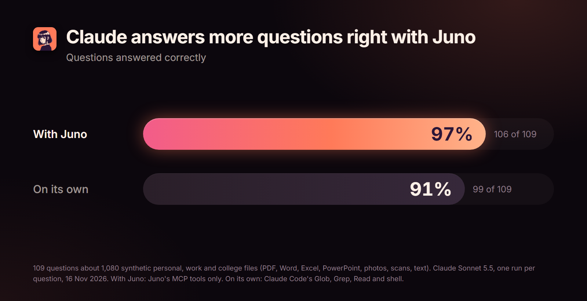

<p align="center">
  
</p>

<h1 align="center">Alfred</h1>

<p align="center">
  Spotlight-style search for Windows that finds your files by what is <b>in</b> them.<br>
  Press <b>Ctrl+Alt+L</b> anywhere. Everything is indexed and searched on your PC.
</p>

<p align="center">
  <a href="docs/ring_compare.mp4"></a>
</p>

<p align="center"><sub>Real recordings, same 1,081 files, same words. File Explorer matches the words against file names; Alfred also reads the text inside the photo.</sub></p>

## What it does

- **Keyword and meaning together.** `banker's algorithm` finds the slide; `kid on a bench in autumn` finds the photo.
- **Reads inside files.** Word, PowerPoint, Excel, PDF (scans included, through OCR), text, photos and video frames.
- **Cites where.** Results point to the page, slide, sheet rows or video timestamp, and Enter opens it there when the app can.
- **Says when it doesn't know.** Weak matches stay hidden behind "Show N weaker matches".
- **Ask Alfred.** Answers from your documents, with citations, using a model on this PC or your Claude / ChatGPT plan.
- **Works with AI tools.** Claude Code, Codex and other MCP clients can search your files through Alfred.

## Benchmark: Claude with and without Alfred

Claude Sonnet 5.5 answered 109 questions about 1,080 synthetic personal, work and college files, once using
Alfred's MCP tools and once using Claude Code's own Glob, Grep, Read and shell.

<p align="center"></p>
<p align="center"></p>
<p align="center"></p>

## Install

1. Install Python 3.11 or newer.
2. Double-click `Setup-Alfred.cmd`. It creates `.venv`, installs the requirements, adds Alfred to the Start menu and starts it.
3. For search by meaning and on-PC answers, put [llama.cpp](https://github.com/ggml-org/llama.cpp) (`llama-server.exe`) in
   `runtime\llama\` (or `ALFRED_LLAMA_DIR`) and the model files in `%LOCALAPPDATA%\Alfred\models\`.
   Alfred starts and stops the engine itself. Keyword search works without it.

No administrator rights needed. Alfred starts hidden in the tray when you sign in (turn this off in Settings).
A folder build that needs no Python is made with `packaging\build.cmd` (see `packaging\README.md`).

## Use

- **Track folders:** Settings (Ctrl+4) → Tracked folders → Track folder…. New, changed and deleted files are picked up automatically.
  For privacy Alfred won't track whole drives, your user folder, Windows, Program Files or AppData, and it skips hidden files and anything that looks like keys or passwords.
- **Search:** type, then Enter to open. Alt+1…Alt+7 filter by kind, Alt+D by date. Esc hides the panel.
- **Ask:** Ctrl+2 or Tab. Pick the model at the top right: on this PC, Claude (Pro/Max), ChatGPT (Plus/Pro), an API key, or any OpenAI-compatible server.
  With a cloud model only your question and the passages found for it are sent, after you allow it once per provider.
- **Shortcut:** Ctrl+Alt+L, falling back to Ctrl+Alt+K or Ctrl+Alt+A if taken. Change it in Settings.

## Connect AI tools (MCP)

Open **Settings → AI tools** and click **Connect** next to your tool. Alfred finds Claude Code, Codex, Claude Desktop,
Cursor, VS Code (Copilot), Windsurf and Gemini CLI, and adds itself through the tool's own `mcp add` command or its MCP
settings file (only Alfred's entry is changed; a file with comments is left alone). Restart the tool if it is open.
For any other MCP tool, **Copy** gives the entry to paste:

```json
{ "mcpServers": { "alfred": {
  "command": "C:\\path\\to\\Alfred\\.venv\\Scripts\\pythonw.exe",
  "args": ["-m", "alfred", "--mcp"],
  "env": { "PYTHONPATH": "C:\\path\\to\\Alfred" } } } }
```

Two read-only tools: `search_files` and `read_passage` (tracked folders only). Alfred asks before a tool's first
search, and logs every call to `mcp_calls.jsonl`.

## Command line

```
python -m alfred --track "C:\Users\me\Documents\Reports"
python -m alfred --search "budget approved"
python -m alfred --status
```

## Development

```
.venv\Scripts\python -m unittest discover -s tests -v
```

Data, settings, index and logs live in `%LOCALAPPDATA%\Alfred` (override with `ALFRED_HOME`).
Search is SQLite FTS5 (BM25) plus EmbeddingGemma 2 vectors, merged by reciprocal-rank fusion; `alfred/rag.py` describes how answers are built.
