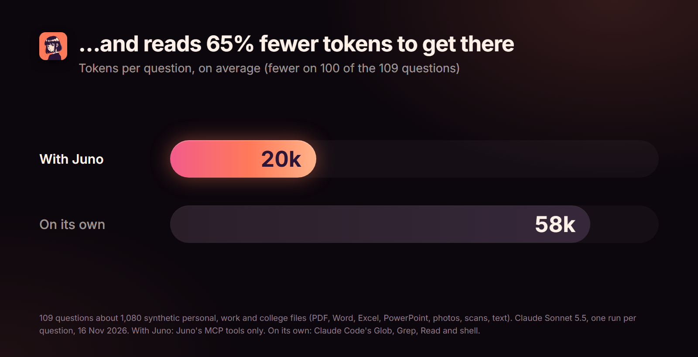
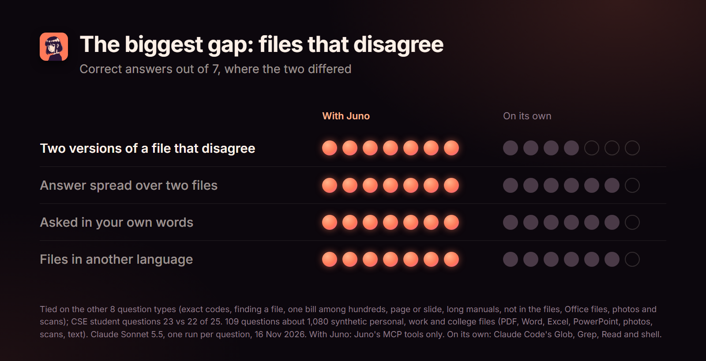

<p align="center">
  
</p>

<h1 align="center">Juno</h1>

<p align="center">
  Spotlight-style search for Windows that finds your files by what is <b>in</b> them.<br>
  Press <b>Ctrl+Alt+L</b> anywhere. Everything is indexed and searched on your PC.
</p>

<p align="center">
  <a href="docs/ring_compare.mp4"></a>
</p>

<p align="center"><sub>Real recordings on the same PC. The whiteboard photo is saved as IMG_20261014_1612.jpg: Windows search offers only web results for "ring counter"; Juno reads the text inside the photo.</sub></p>

## What it does

- **Keyword and meaning together.** `banker's algorithm` finds the slide; `kid on a bench in autumn` finds the photo.
- **Reads inside files.** Word, PowerPoint, Excel, PDF (scans included, through OCR), text, photos and video frames.
- **Cites where.** Results point to the page, slide, sheet rows or video timestamp, and Enter opens it there when the app can.
- **Says when it doesn't know.** Weak matches stay hidden behind "Show N weaker matches".
- **Ask Juno.** Answers from your documents, with citations, using a model on this PC or your Claude / ChatGPT plan.
- **Works with AI tools.** Claude Code, Codex and other MCP clients can search your files through Juno, and the code
  in your folders too: by what it does, by name, and by what calls it.

## Benchmark: Claude with and without Juno

Claude Sonnet 5.5 answered 109 questions about 1,080 synthetic personal, work and college files, once using
Juno's MCP tools and once using Claude Code's own Glob, Grep, Read and shell.

<p align="center"></p>
<p align="center"></p>
<p align="center"></p>

## Install

The quickest way: download `Juno-<version>-win64.zip` from [Releases](https://github.com/ScriptSage1/Juno/releases),
unzip it and run `Juno.exe`. It needs no Python, and search by meaning works straight away (the engine and search
model come in the zip).

From source:

1. Install Python 3.11 or newer.
2. Double-click `Setup-Juno.cmd`. It creates `.venv`, installs the requirements, adds Juno to the Start menu and starts it.
3. For search by meaning and on-PC answers, put [llama.cpp](https://github.com/ggml-org/llama.cpp) (`llama-server.exe`) in
   `runtime\llama\` (or `JUNO_LLAMA_DIR`) and the model files in `%LOCALAPPDATA%\Juno\models\`.
   Juno starts and stops the engine itself. Keyword search works without it.

No administrator rights needed. Juno starts hidden in the tray when you sign in (turn this off in Settings).
A folder build that needs no Python is made with `packaging\build.cmd` (see `packaging\README.md`).

## Use

- **Track folders:** Settings (Ctrl+4) → Tracked folders → Track folder…. New, changed and deleted files are picked up automatically.
  For privacy Juno won't track whole drives, your user folder, Windows, Program Files or AppData, and it skips hidden files and anything that looks like keys or passwords.
- **Search:** type, then Enter to open. Alt+1…Alt+7 filter by kind, Alt+D by date. Esc hides the panel.
- **Ask:** Ctrl+2 or Tab. Pick the model at the top right: on this PC, Claude (Pro/Max), ChatGPT (Plus/Pro), an API key, or any OpenAI-compatible server.
  With a cloud model only your question and the passages found for it are sent, after you allow it once per provider.
- **Shortcut:** Ctrl+Alt+L, falling back to Ctrl+Alt+K or Ctrl+Alt+A if taken. Change it in Settings.

## Connect AI tools (MCP)

Open **Settings → AI tools** and click **Connect** next to your tool. Juno finds Claude Code, Codex, Claude Desktop,
Cursor, VS Code / VS Code Insiders (Copilot), Windsurf and Gemini CLI, and adds itself through the tool's own `mcp add`
command or its MCP settings file (only Juno's entry is changed, the original file is kept as `*.before-juno`, and a
file with comments is left alone). It then starts the server exactly as the tool will and checks that it answers.
Restart the tool if it is open. For any other MCP tool, **Copy** gives the entry to paste:

```json
{ "mcpServers": { "juno": {
  "command": "C:\\path\\to\\Juno\\.venv\\Scripts\\pythonw.exe",
  "args": ["-m", "juno", "--mcp"],
  "env": { "PYTHONPATH": "C:\\path\\to\\Juno" } } } }
```

Read-only tools, for tracked folders only: `search_files` and `read_passage` for your files, and `search_code` for the
code in them (Python, JavaScript, TypeScript, Go, Rust, Java, C, C++, C# and more). `search_code` combines search by meaning,
keywords and symbol names, and gives each match with its file, line range, snippet, and its callers and callees (Python).
It is on by default; turn it off under Settings → Search → Search code. Juno asks before a tool's first search, and logs
every call to `mcp_calls.jsonl`.

## Command line

```
python -m juno --track "C:\Users\me\Documents\Reports"
python -m juno --search "budget approved"
python -m juno --status
```

## Development

```
.venv\Scripts\python -m unittest discover -s tests -v
```

Data, settings, index and logs live in `%LOCALAPPDATA%\Juno` (override with `JUNO_HOME`).
Search is SQLite FTS5 (BM25) plus EmbeddingGemma 2 vectors, merged by reciprocal-rank fusion; `juno/rag.py` describes how answers are built.
